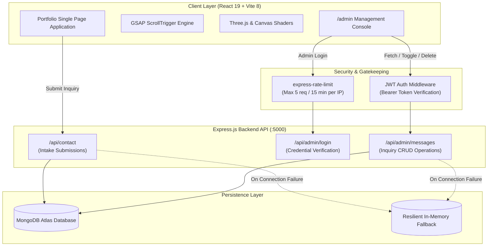

<div align="center">

# ⚡ Naqsh — Full-Stack Developer Portfolio

**A high-performance, dark architectural developer portfolio crafted with precision geometry, interactive 3D WebGL visuals, real-time spring physics, bidirectional GSAP animations, and a secure Express/MongoDB admin backend.**

<br />

[](https://react.dev/)
[](https://vitejs.dev/)
[](https://tailwindcss.com/)
[](https://threejs.org/)
[](https://greensock.com/)
[](https://nodejs.org/)
[](https://www.mongodb.com/)
[](LICENSE)

<br />

[Explore Features](#-architecture--core-features) •
[Tech Stack](#-technology-stack) •
[Architecture](#-system-architecture) •
[Quickstart](#-getting-started) •
[API Reference](#-api-reference) •
[Connect](#-author--contact)

</div>

---

## 📌 Overview

This repository houses the personal portfolio and client inquiry management platform for **Muhammad Naqsh**. Engineered with a focus on modern aesthetic craft and structural hierarchy, the user interface features a bespoke **Architectural Obsidian Chassis Design System** with custom chamfer geometries, directional elevation shadows, and vibrant neon violet accents.

Backed by a production-ready Express API with MongoDB persistence, the system includes an authenticated admin dashboard, automatic subject pre-fill routing, and strict security rate-limiting.

---

## ✨ Architecture & Core Features

### 1. 🌌 Interactive 3D WebGL & Canvas Visuals
* **WebGL Grid Trails**: Custom 60 FPS interactive grid background rendered on HTML5 canvas with real-time pointer particle trails.
* **Ridgeline WebGL Flyover**: Dynamic wireframe mountain terrain simulation beneath the contact portal featuring real-time pulse scanning.
* **Three.js Ecosystem**: Built with `@react-three/fiber` and `@react-three/drei` for zero layout shift during 3D asset initialization.

### 2. 🔤 Weight Sweep Typographic Preloader
* High-precision variable-weight typographic animation (`000%` → `100%`) tracking simulated asset initialization.
* Hardware-accelerated lift transition revealing the UI with smooth cubic-bezier easing.

### 3. 📐 Architectural Chassis Design System
* **Precision Chassis Surfaces**: Built with balanced structural hierarchy using tailored corner radii (`rounded-xl`, `rounded-lg`, `rounded-md`), directional depth elevation (`shadow-[0_8px_30px_rgba(0,0,0,0.6)]`), and crisp white hairline inset highlights (`inset 0 1px 0 rgba(255,255,255,0.08)`).
* **Conic Gradient Shiny Buttons**: Custom `@property --gradient-angle` CSS houdini animated borders paired with architectural button geometry.

### 4. 🚀 Bidirectional GSAP Scroll Engine (Zero Desync)
* **Snappy Entrance**: Triggered at `start: "top 95%"`, completing within `0.25s` to eliminate slow or delayed element rendering.
* **True Bidirectional Reversal**: Configured with `toggleActions: "play none none reverse"`—elements smoothly fade in as they enter and gracefully fade out when scrolling in reverse.
* **Dynamic Refresh Sync**: Automated `ScrollTrigger.refresh()` hooks trigger when the preloader finishes, web fonts load, or viewports resize.

### 5. 🗂️ Motion Tiles 3D Project Showcase
* Isometric interactive 3D perspective project deck with category filter badges, real-time modal previews, live demo redirects, and GitHub repository links.

### 6. 🛠️ Services Matrix & Automated Inquiry Routing
* 2x2 responsive services grid detailing Full-Stack Engineering, Frontend & Interactive Interfaces, Backend APIs, and Performance Optimization.
* **One-Click Pre-populate**: Clicking **"Inquire Now"** automatically pre-fills the Contact Form's subject field and smoothly scrolls to `#contact`.

### 7. ⏱️ Milestone Engineering Process Roadmap
* Vertical timeline detailing real-world engineering workflows from Architecture & Schema Design to Production Cloud Launch.
* Scroll-driven center neon rail with dynamic height tracking and alternating milestone deliverable cards.

### 8. 🔠 Spring Physics Typographic Wordmark (`NAQSH`)
* Interactive letter simulation powered by custom velocity, damping, and restitution spring physics.
* Letters react dynamically to pointer proximity, sideways impulse waves, and ripple kicks.

### 9. 🔝 Persistent Floating Action Button (`BackToTop`)
* Elevated circular obsidian glass button (`rounded-full w-12 h-12`) with `backdrop-blur-xl`, neon violet border, ambient glow, and centered architectural Lucide `LuArrowUp` icon.
* Fixed at `bottom-5 right-5 sm:bottom-8 sm:right-8 z-50` with smooth scroll-to-top behavior.

### 10. 🛡️ Protected Admin Management Console
* **Strict Rate Limiting**: Built-in IP-based rate limiting on `/api/admin/login` (maximum 5 attempts every 15 minutes).
* **JWT Authentication**: Secure Bearer token verification protecting all inbound inquiries endpoints.
* **Message Triage**: Filter by read/unread, instant search across client messages, read status toggle, and deletion with confirmation modals.

---

## 🛠️ Technology Stack

| Domain | Technology | Purpose |
| :--- | :--- | :--- |
| **Frontend Framework** | [React 19](https://react.dev/) | Component architecture & reactive UI state |
| **Build Tool** | [Vite 8](https://vitejs.dev/) | Lightning-fast HMR and optimized Rolldown production bundles |
| **Styling & Tokens** | [Tailwind CSS 3.4](https://tailwindcss.com/) | Utility-first design tokens, custom colors, and responsive layouts |
| **Animation & Motion** | [GSAP 3.15](https://greensock.com/) + ScrollTrigger | High-performance scroll-driven timelines & bidirectional transitions |
| **3D & WebGL Graphics** | [Three.js](https://threejs.org/) + R3F + Drei | Hardware-accelerated 3D canvases and interactive shaders |
| **Icons** | [React Icons](https://react-icons.github.io/react-icons/) (Lu, Fi, Fa) | Clean architectural SVG symbols |
| **Backend Runtime** | [Node.js](https://nodejs.org/) & [Express 4](https://expressjs.com/) | RESTful API server architecture & route handling |
| **Database** | [MongoDB](https://www.mongodb.com/) via [Mongoose 8](https://mongoosejs.com/) | Document persistence with automatic in-memory fallback layer |
| **Security & Auth** | [express-rate-limit](https://github.com/express-rate-limit/express-rate-limit) + [jsonwebtoken](https://github.com/auth0/node-jsonwebtoken) | Brute-force protection & JWT-based session security |

---

## 🏗️ System Architecture



---

## 📁 Project Structure

```text
Naqsh-Portfolio/
├── Backend/
│   ├── config/
│   │   └── db.js                        # Resilient MongoDB Mongoose connection & fallback
│   ├── controllers/
│   │   ├── adminController.js           # JWT authentication & inquiry triage logic
│   │   └── contactController.js         # Public inquiry submission intake
│   ├── middleware/
│   │   └── authMiddleware.js            # Strict Bearer token verification
│   ├── models/
│   │   └── Message.js                   # Mongoose Message schema
│   ├── routes/
│   │   ├── adminRoutes.js               # Admin endpoints with rate-limiting applied
│   │   └── contactRoutes.js             # Public contact intake routes
│   ├── app.js                           # Express application & middleware configuration
│   ├── server.js                        # Server entry point & port listening
│   └── package.json
│
├── FrontEnd/
│   ├── src/
│   │   ├── components/
│   │   │   ├── ui/
│   │   │   │   ├── ShinyButton.jsx      # Houdini conic gradient shimmer button
│   │   │   │   ├── motion-tiles.jsx     # 3D isometric project showcase deck
│   │   │   │   └── weight-sweep-preloader.jsx # Variable-weight typographic preloader
│   │   │   ├── BackToTop.jsx            # Persistent floating action button (FAB)
│   │   │   ├── CursorDotTrail.jsx       # Custom interactive cursor particle trail
│   │   │   ├── FooterField.jsx          # Interactive spring-physics typographic wordmark
│   │   │   ├── GridTrails.jsx           # Canvas grid animation with real-time glow
│   │   │   ├── MilestoneProcessScroll.jsx # Central rail scroll roadmap
│   │   │   ├── Navbar.jsx               # Segmented console navigation & mobile drawer
│   │   │   ├── RidgelineTerrain.jsx     # High-performance WebGL wireframe terrain
│   │   │   └── ServicesSection.jsx      # Responsive services matrix with inquiry routing
│   │   ├── pages/
│   │   │   ├── AdminDashboard.jsx       # Protected admin management portal
│   │   │   └── Home.jsx                 # Single-page portfolio application
│   │   ├── utils/
│   │   │   └── apiConfig.js             # Dynamic environment-aware API URL selector
│   │   ├── data.js                      # Centralized profile, skills & project data
│   │   ├── App.jsx                      # App root, router & global components
│   │   ├── index.css                    # Design tokens, chamfer classes & global styles
│   │   └── main.jsx                     # Vite client entry point
│   ├── index.html
│   ├── tailwind.config.js
│   ├── vite.config.js
│   └── package.json
│
└── README.md
```

---

## 🚀 Getting Started

### Prerequisites
* [Node.js](https://nodejs.org/) (v18 or higher recommended)
* [npm](https://www.npmjs.com/) or [yarn](https://yarnpkg.com/)
* [MongoDB](https://www.mongodb.com/) (Local instance or free MongoDB Atlas URI)

### 1. Clone the Repository
```bash
git clone https://github.com/Naqsh786/Naqsh-Portfolio.git
cd Naqsh-Protfolio
```

### 2. Configure Backend
1. Navigate to the `Backend` directory:
   ```bash
   cd Backend
   npm install
   ```
2. Create your `.env` configuration file in the `Backend` root:
   ```bash
   cp .env.example .env   # Or create .env manually
   ```
3. Populate the required environment variables:
   ```env
   PORT=5000
   MONGO_URI=your_mongodb_uri_here
   ADMIN_PASSWORD=your_strong_admin_password_here
   JWT_SECRET=your_super_secret_jwt_key_here
   ```
4. Start the backend development server:
   ```bash
   npm run dev
   ```
   *Backend starts listening at `http://localhost:5000`.*

### 3. Configure Frontend
1. Open a second terminal window and navigate to `FrontEnd`:
   ```bash
   cd FrontEnd
   npm install
   ```
2. Start the Vite development server:
   ```bash
   npm run dev
   ```
3. Open the URL shown in your terminal (typically `http://localhost:5173` or `http://localhost:5174`).

---

## 🔒 API Reference

### Public Endpoints

| Method | Endpoint | Description | Payload | Rate Limit |
| :--- | :--- | :--- | :--- | :--- |
| `POST` | `/api/contact` | Submit inquiry from contact form | `{ name, email, subject, message }` | Standard |

### Admin Endpoints (Secured)

| Method | Endpoint | Description | Headers | Rate Limit |
| :--- | :--- | :--- | :--- | :--- |
| `POST` | `/api/admin/login` | Authenticate admin | `{ password }` | **Strict (5 req / 15 min)** |
| `GET` | `/api/admin/messages` | Retrieve all client inquiries | `Authorization: Bearer <token>` | Standard |
| `GET` | `/api/admin/stats` | Message analytics (total, read, unread) | `Authorization: Bearer <token>` | Standard |
| `PATCH` | `/api/admin/messages/:id/read` | Toggle read/unread status | `Authorization: Bearer <token>` | Standard |
| `DELETE` | `/api/admin/messages/:id` | Remove an inquiry record | `Authorization: Bearer <token>` | Standard |

---

## 🛡️ Security Hardening

* **Brute-Force Protection**: The `/api/admin/login` endpoint is guarded by `express-rate-limit`, permitting at most 5 attempts per 15-minute window per IP.
* **Zero Secret Leakage**: No passwords or fallback strings are logged to server output or hardcoded in source. Missing environment variables trigger immediate silent 500 errors.
* **JWT Stateless Sessions**: Signed tokens expire after 24 hours and verify against an isolated cryptographic secret.
* **Resilient In-Memory Fallback**: If MongoDB connection is lost or offline during development, the backend activates a memory store so clients can continue testing contact submissions without downtime.

---

## 📦 Build & Quality Verification

Run ESLint to check for syntax and style standards:
```bash
cd FrontEnd
npm run lint
```

Compile the optimized, minified production distribution:
```bash
cd FrontEnd
npm run build
```

Preview the compiled distribution locally:
```bash
cd FrontEnd
npm run preview
```

---

## 📬 Author & Contact

**Muhammad Naqsh** — *Full-Stack Engineer*

* 🌐 **GitHub**: [@Naqsh786](https://github.com/Naqsh786)
* ✉️ **Email**: [naqshcc916@gmail.com](mailto:naqshcc916@gmail.com)

---

<div align="center">
  <sub>Built with precision, passion, and modern web engineering. Distributed under the MIT License.</sub>
</div>
